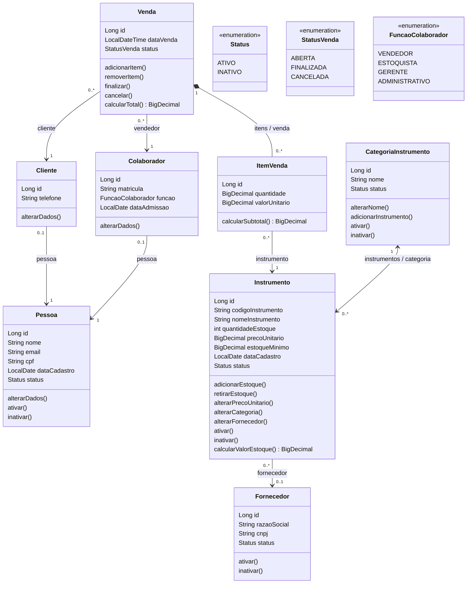

# Modelagem e decisões arquiteturais — Aula 10

Este documento descreve o domínio implementado em `instrumento2026`, conferido nas entidades, em `VendaService` e na migração 005. O diagrama representa o modelo persistido válido; objetos em construção podem ainda não ter todas as associações preenchidas.

## Diagrama de classes

O diagrama é mantido diretamente neste bloco Mermaid, editável como texto e renderizável na visualização Markdown do GitHub. Os atributos escalares e os principais comportamentos aparecem nas classes; as referências e coleções entre entidades aparecem nas linhas de associação. Getters, construtores e validadores privados foram omitidos.

`-->` indica navegação por referência; `<-->` indica navegação nos dois sentidos. O losango preenchido em `Venda` indica composição com responsabilidade pelo ciclo de vida dos itens. A escolha de composição para os papéis de pessoa significa usar referências em vez de herança; ela não implica exclusão em cascata nem propriedade exclusiva sobre a pessoa.

## Cardinalidades conferidas no código

Os caminhos Java desta tabela partem de [domain](../../src/main/java/com/curso/instrumento2026/domain).

| Associação | Cardinalidade e implementação real |
|---|---|
| Cliente → Pessoa | Cada cliente referencia exatamente uma pessoa. Uma pessoa tem zero ou um cliente: `Cliente.pessoa` usa `@OneToOne(optional = false)` e `pessoa_id` único. |
| Colaborador → Pessoa | Cada colaborador referencia exatamente uma pessoa. Uma pessoa tem zero ou um colaborador, independentemente de também ser cliente: `Colaborador.pessoa` tem o mesmo mapeamento obrigatório e único. |
| Venda → Cliente | Toda venda tem um cliente; um cliente pode participar de zero a muitas vendas. `Venda.cliente` é `@ManyToOne(optional = false)`. |
| Venda → Colaborador | Toda venda tem um colaborador vendedor; um colaborador pode atender zero a muitas vendas. `Venda.vendedor` é `@ManyToOne(optional = false)`. A função permitida é regra do service, não cardinalidade. |
| Venda ↔ ItemVenda | Uma venda pode ter zero a muitos itens; cada item pertence a uma venda. `Venda.itens` usa `mappedBy = "venda"`, `cascade = ALL`, `orphanRemoval = true` e ordenação por ID; `ItemVenda.venda` é obrigatório. Venda aberta ou cancelada pode estar vazia; finalizada deve ter ao menos um item. |
| ItemVenda → Instrumento | Cada item referencia exatamente um instrumento; um instrumento pode aparecer em zero a muitos itens de vendas distintas. `ItemVenda.instrumento` é `@ManyToOne(optional = false)`. O par venda/instrumento é único. |
| CategoriaInstrumento ↔ Instrumento | Cada instrumento persistido pertence a uma categoria; uma categoria pode classificar zero a muitos instrumentos. `Instrumento.categoria` é obrigatório; `CategoriaInstrumento.instrumentos` usa `mappedBy = "categoria"`. |
| Instrumento → Fornecedor | Cada instrumento pode não ter fornecedor ou ter um; um fornecedor pode fornecer zero a muitos instrumentos. `Instrumento.fornecedor` é `@ManyToOne` com FK opcional. Não há coleção inversa em `Fornecedor`. |

As setas não pressupõem coleções inexistentes: `Pessoa` não mantém listas de clientes ou colaboradores; estes papéis também não mantêm listas de vendas. A migração [005-pessoas-clientes-vendas.yaml](../../src/main/resources/db/changelog/changes/005-pessoas-clientes-vendas.yaml) reforça obrigatoriedade, unicidade e integridade referencial das novas associações.

## Identidade e papéis: composição em vez de subclasses

[Pessoa](../../src/main/java/com/curso/instrumento2026/domain/Pessoa.java) centraliza nome, e-mail normalizado, CPF, data de cadastro e status. [Cliente](../../src/main/java/com/curso/instrumento2026/domain/Cliente.java) acrescenta telefone; [Colaborador](../../src/main/java/com/curso/instrumento2026/domain/Colaborador.java) acrescenta matrícula, função e admissão. Os papéis têm IDs próprios e compartilham a identidade por `pessoa_id`.

Na loja, quem trabalha como vendedor também pode comprar um instrumento. Duas linhas de papéis podem apontar para a mesma pessoa, mantendo uma única origem para CPF e e-mail. A unicidade de `pessoa_id` vale separadamente em cada tabela: impede repetir o mesmo papel e permite assumir ambos.

Uma hierarquia `Cliente extends Pessoa` e `Colaborador extends Pessoa` tornaria esses papéis tipos de objeto. Uma instância Java não pode pertencer simultaneamente a duas subclasses irmãs; acomodar as combinações exigiria tipos adicionais ou outra forma de associação. Duplicar a pessoa para representar cada papel fragmentaria sua identidade. As estratégias JPA `SINGLE_TABLE`, `JOINED` e `TABLE_PER_CLASS` organizam a persistência de uma hierarquia, mas não resolvem por si sós a participação simultânea.

Herança pode ser adequada quando há especializações estáveis e substituíveis pelo tipo base, preservando seu contrato. Aqui a decisão acompanha papéis acumuláveis e dados próprios de cada vínculo. Não há `extends Pessoa` nem configuração de herança JPA entre as três classes.

Inativar a pessoa altera seu status, sem apagar a identidade, os papéis ou as vendas. Os services exigem pessoa ativa ao criar papéis e ao abrir/finalizar vendas; as referências preservam a consulta ao histórico. Matrícula e função podem mudar, mas a alteração comum do colaborador preserva a pessoa e a data de admissão.

## ItemVenda e a relação entre venda e instrumento

Conceitualmente, uma venda contém vários instrumentos e cada instrumento de catálogo pode participar de várias vendas. [ItemVenda](../../src/main/java/com/curso/instrumento2026/domain/ItemVenda.java) materializa essa relação N:M por duas associações N:1, acrescentando identidade própria, quantidade e preço praticado. Um `@ManyToMany` direto não representaria esses atributos comerciais.

O item nasce por `Venda.adicionarItem`; seu construtor de negócio tem visibilidade de pacote. A venda impede repetir o instrumento e o banco reforça a regra com `uk_item_venda_instrumento`. A quantidade é positiva, inteira e limitada a `Integer.MAX_VALUE`, embora o campo Java seja `BigDecimal` e a coluna seja `NUMERIC(18,3)`. Valores como `2.000` representam duas unidades; frações como `1.5` são rejeitadas no domínio e pelo `CHECK` do banco.

A remoção de um item da coleção elimina sua linha por `orphanRemoval`. A FK de venda para item permite cascata de exclusão; a FK do item para instrumento usa `RESTRICT`, preservando o instrumento referenciado. A API não oferece exclusão de venda. Tentar excluir um instrumento vinculado a item retorna `409`; essa proteção também se aplica a itens de vendas ainda abertas ou canceladas.

## Preço histórico e valores calculados

Ao adicionar um instrumento, [Venda.adicionarItem](../../src/main/java/com/curso/instrumento2026/domain/Venda.java) copia `Instrumento.precoUnitario` para `ItemVenda.valorUnitario`. O subtotal usa essa cópia, e não uma nova consulta ao preço de catálogo. Assim, uma alteração posterior do preço não reescreve o valor comercial já registrado no item.

O subtotal é `quantidade × valorUnitario`, arredondado para duas casas com `HALF_UP`. O total soma os subtotais e também retorna duas casas; ambos usam `BigDecimal`. Não existem colunas de subtotal ou total: esses valores são derivados dos itens. O preço do item aceita valor não negativo; o preço atual do instrumento é validado como estritamente positivo no domínio.

O snapshot é capturado na inclusão, mesmo enquanto a venda está aberta. Remover e reincluir um instrumento cria outro item com o preço vigente nessa nova inclusão. O histórico preservado é o preço e a quantidade do item: nomes e dados civis continuam vindo das entidades referenciadas, sem cópias históricas próprias.

## Estoque e finalização transacional

Abrir a venda, incluir ou remover itens não reserva nem baixa estoque. O status começa em `ABERTA`; apenas nesse estado são aceitos inclusão, remoção, finalização e cancelamento. `Venda.finalizar()` rejeita venda vazia e altera o status. A coordenação da baixa pertence a [VendaService.finalizar](../../src/main/java/com/curso/instrumento2026/service/VendaService.java):

1. Carrega venda, participantes, pessoas, itens e instrumentos.
2. Exige venda aberta, pessoas do cliente e do vendedor ativas e função `VENDEDOR` ou `GERENTE`.
3. Para cada item, exige instrumento ativo e chama `Instrumento.retirarEstoque` com a quantidade inteira. O instrumento rejeita quantidade inválida ou saldo insuficiente.
4. Chama `Venda.finalizar()`. A transação confirma a mudança de estado e todas as baixas juntas, por dirty checking das entidades gerenciadas.

O método possui `@Transactional`. Se um item posterior não tiver saldo, a exceção de execução propaga-se e reverte as baixas anteriores; a venda permanece aberta no banco. Uma segunda finalização é recusada antes das baixas, com `400`. Cancelar uma venda aberta apenas muda o estado para `CANCELADA`, sem movimentar estoque; não há estorno de venda finalizada. As vendas encerradas rejeitam as operações comuns sobre os itens.

A atomicidade protege uma execução do caso de uso. O modelo atual não possui locking explícito nem atributo `@Version` para controlar duas vendas concorrentes sobre o mesmo saldo; `@Transactional` sozinho não elimina essa disputa. Essa evolução permanece fora do recorte atual.

## Adaptação para a loja de instrumentos musicais

| Conceito do exemplo didático | Implementação no projeto e decisão |
|---|---|
| Produto | `Instrumento`: registro de catálogo com código único, nome, preço e quantidade disponível. Não representa cada unidade física por número de série. |
| GrupoProduto | `CategoriaInstrumento`: classifica o catálogo em categorias como cordas ou sopros. A associação é obrigatória para persistir o instrumento. |
| Saldo quantitativo | `Instrumento.quantidadeEstoque` usa `int`: a loja vende unidades inteiras. O item conserva `BigDecimal`, com validação e restrição de banco para integralidade. |
| Preço atual e preço vendido | `Instrumento.precoUnitario` é o preço de catálogo; `ItemVenda.valorUnitario` é a cópia histórica. |
| Fornecimento | `Fornecedor`, separado de `Pessoa`, identifica a empresa por CNPJ; o vínculo com instrumento é opcional. |
| Participantes da venda | `Pessoa` identifica a pessoa física por CPF; cliente e colaborador são papéis acumuláveis, adequados a funcionários que também compram na loja. |
| Fato comercial | `Venda` coordena itens de instrumentos e tem seu estoque baixado somente na finalização transacional. |

CPF e CNPJ são validados no domínio e na entrada da API, incluindo os dígitos verificadores. Isso verifica consistência matemática, sem consultar existência ou titularidade. Função profissional é uma regra comercial, não uma autoridade de acesso: `GERENTE` pode vender, mas não recebe automaticamente permissões administrativas. Não existem credenciais nas entidades. Uma futura conta de acesso poderia referenciar `Pessoa`, mantendo autenticação e autorização separadas dos papéis comerciais; ela não faz parte do diagrama implementado.

## Evidências para conferir e manter o documento

| Decisão documentada | Evidência existente no projeto |
|---|---|
| Pessoa com dois papéis e alterações restritas ao vínculo | [PessoasEPapeisServiceTest](../../src/test/java/com/curso/instrumento2026/service/PessoasEPapeisServiceTest.java), `devePermitirDoisPapeisEAlterarSomenteSeusDadosEditaveis` |
| Preço histórico e estados da venda | [VendaTest](../../src/test/java/com/curso/instrumento2026/domain/VendaTest.java), `deveManterPrecoHistoricoSubtotalETotalSemBaixarEstoque` e `deveBloquearTodasAsAlteracoesAposEncerramento` |
| Baixa única, rollback com dois instrumentos e cancelamento sem baixa | [VendaServiceTest](../../src/test/java/com/curso/instrumento2026/service/VendaServiceTest.java), `deveFinalizarBaixandoCadaItemUmaVezEPreservandoPrecoHistorico`, `deveFazerRollbackDaPrimeiraBaixaSeSegundoItemNaoTemSaldo` e `deveCancelarSemBaixarEstoqueEBloquearAlteracoesPosteriores` |
| Integridade de FKs, unicidade e quantidades | [MigracaoAula10Test](../../src/test/java/com/curso/instrumento2026/MigracaoAula10Test.java) e migração 005 |
| Instrumento vendido e histórico preservados após exclusão recusada | [Aula10Passo8ApiTest](../../src/test/java/com/curso/instrumento2026/Aula10Passo8ApiTest.java), `deveImpedirExcluirInstrumentoVendidoEPreservarHistorico` |

Ao mudar o modelo, confira novamente os tipos, a obrigatoriedade das FKs, as unicidades, os dois lados das associações bidirecionais e os limites de estado descritos aqui. A tabela de evidências referencia testes existentes; esta entrega documental não constitui nova execução da suíte nem a entrega da atividade orientada.

Referência de escopo: [Aula 10 do professor Jefferson — modelagem, composição, entidade associativa e transferência para o tema](https://github.com/jeffersonarpasserini/suporteos2026/blob/main/docs/10aula/10aula.md).
