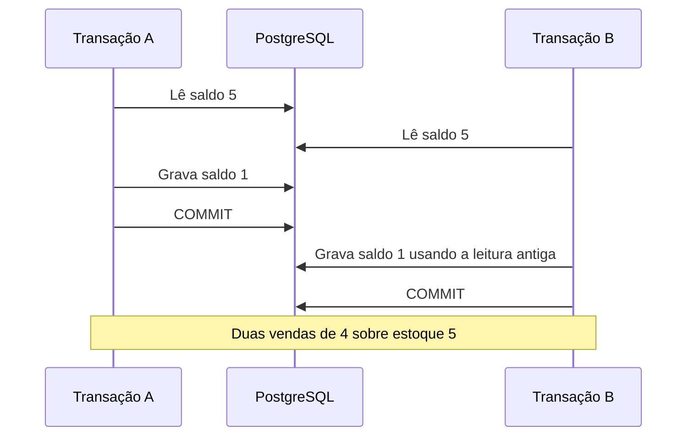

# Atividade orientada — Aula 11

## Cenário da loja

Duas vendas distintas contêm quatro unidades do mesmo instrumento; o saldo inicial é cinco. A identidade da vencedora não é fixada. As evidências vêm dos testes JPA com PostgreSQL real, não de requisições executadas por Postman.

## Intercalação vulnerável — explicação conceitual



Este primeiro diagrama explica o defeito; não representa uma execução registrada com o lock removido.

## Coordenação implementada

```mermaid
sequenceDiagram
    participant A as Transação A
    participant DB as PostgreSQL
    participant B as Transação B
    A->>DB: BEGIN; bloqueia sua venda
    B->>DB: BEGIN; bloqueia outra venda
    A->>DB: Refresh e lock do instrumento; saldo 5
    B->>DB: Solicita o mesmo lock
    Note over B,DB: Aguarda liberação
    A->>DB: Baixa 4; finaliza venda; COMMIT
    DB-->>B: Lock adquirido; saldo atualizado 1
    B->>B: Retirada de 4 rejeitada
    B->>DB: ROLLBACK
```

O diagrama descreve a ordem lógica esperada; os testes não registram timestamps de cada aquisição ou a duração de espera no banco.

## Interpretação do resultado — até 300 palavras

O estoque é um recurso escasso compartilhado entre requisições. Atomicidade permite desfazer todas as baixas de uma venda, mas não impede leituras concorrentes do mesmo saldo. A estratégia pessimista coordena a decisão no PostgreSQL. Após o primeiro commit, a transação seguinte precisa recarregar o saldo antes de decidir.

O teste obrigatório prepara saldo cinco e duas vendas de quatro. Cada thread abre uma transação e carrega os dados antes do sinal comum. Exatamente uma venda finaliza; a outra falha por `Estoque insuficiente` e permanece `ABERTA`. O saldo persistido é um. As consultas finais são realizadas depois das transações.

A finalização adquire primeiro o bloqueio da venda, validando o status atual por projeção, e depois os instrumentos em ID crescente. Isso também impede uma segunda baixa da mesma venda. Ordenar recursos reduz ciclos de espera; não garante ausência de deadlock em fluxos maiores.

O preço histórico permanece no item. O estoque continua inteiro e não há reserva na abertura ou inclusão. Não foi necessário changelog, pois a evolução altera comportamento e geração de SQL, sem modificar a estrutura persistida.

## Evidência mínima e limites

| Conferência | Resultado registrado |
|---|---|
| Transações | Duas threads, contextos independentes, barreira antes da finalização |
| Vendas diferentes, saldo 5, retirada 4 por venda | Um sucesso; uma falha por estoque insuficiente |
| Estados no banco | Uma FINALIZADA e uma ABERTA |
| Saldo final | 1 |
| Estabilidade inicial | Cinco execuções isoladas aprovadas |
| Repetição após bloquear a própria venda | Três rodadas aprovadas para cada um dos dois cenários de vendas |

Os comandos, resultados e a reprodução da mesma venda estão em [EVIDENCIAS](EVIDENCIAS.md). O exercício de remover o lock e o experimento opcional em consoles não foram realizados. A atividade está documentada com as execuções efetivamente disponíveis, sem afirmar essa parte experimental como concluída.
