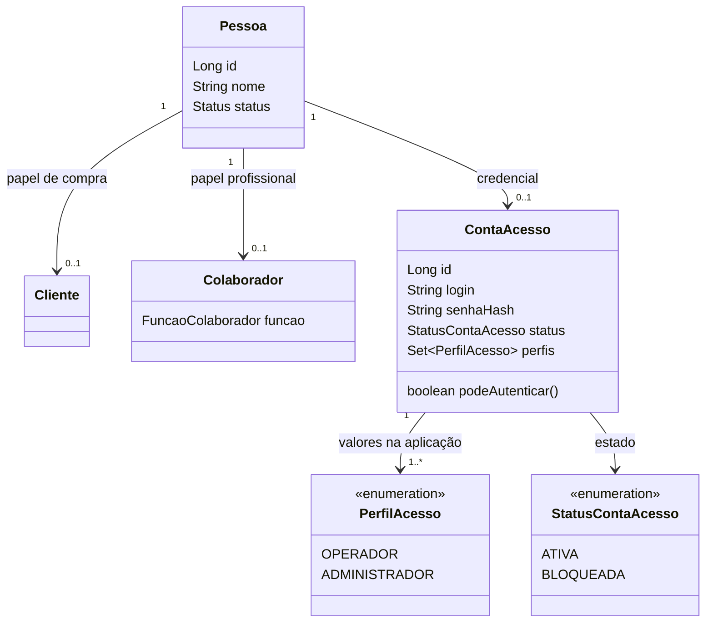
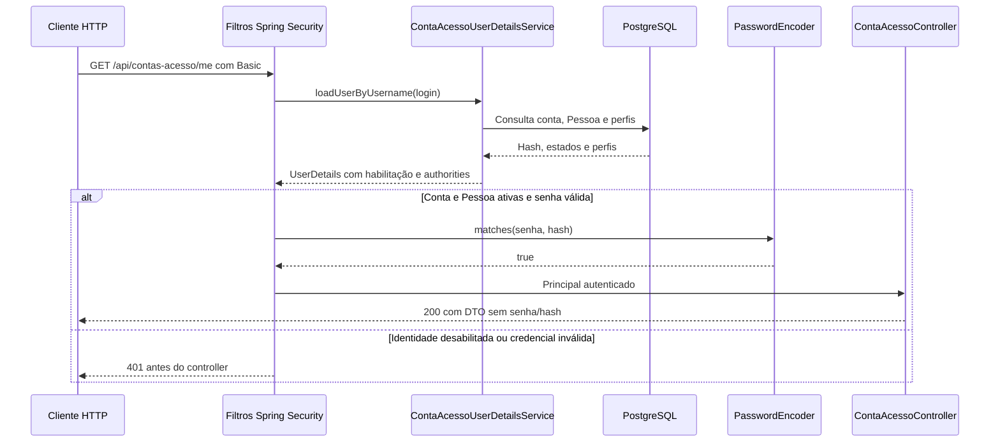

# Atividade orientada — Aula 12

[Índice da aula](README.md) · [Decisões técnicas](SEGURANCA.md) · [Evidências](EVIDENCIAS.md)

Realização da atividade de transferência da seção 13 do [material do professor](https://github.com/jeffersonarpasserini/suporteos2026/blob/main/docs/12aula/12aula.md), adaptada à loja de instrumentos musicais. Os diagramas são explicações do modelo/código, não capturas de execução.

## Identidade, papel e credencial

A mesma Pessoa pode comprar como Cliente, atuar como Colaborador e possuir ContaAcesso. Esses vínculos são independentes. Uma pessoa que trabalha com vendas não recebe automaticamente uma credencial. A credencial também não torna alguém vendedor habilitado nas regras de VendaService.

OPERADOR representa uma conta de uso da API da loja. ADMINISTRADOR reserva a possibilidade de administração futura, mas não concede poderes extras nesta aula. FuncaoColaborador continua descrevendo trabalho comercial; não é convertida em authority.

A multiplicidade mínima de perfis representa a regra da aplicação; não significa que a FK ou o CHECK obriguem a existir uma linha em `conta_acesso_perfil`. O hash está na entidade persistida, mas não no DTO retornado pela API.

## Correspondência com os nove itens da atividade

| Item do professor | Realização no instrumento2026 |
|---|---|
| Identificar a entidade de pessoa | Pessoa mantém identidade civil, sem senha |
| Separar conta de papéis comerciais | ContaAcesso referencia Pessoa e não depende de Cliente/Colaborador |
| Definir dois perfis | OPERADOR e ADMINISTRADOR, sem diferenciação de permissões nesta aula |
| Persistir somente hash | Encoder delegante/BCrypt e testes `matches`, salt e ausência de credenciais nas respostas |
| Documentar bootstrap provisório | Cadastro público por pessoaId e risco de vinculação indevida descritos em SEGURANCA e POSTMAN |
| Proteger uma rota | GET `/api/instrumentos` exige Basic; o filtro cobre também as demais rotas comerciais |
| Testar anônimo, válido e bloqueado | MockMvc com filtros ativos e Newman com fixture de bloqueio preparada por SQL |
| Desenhar o modelo atualizado | Diagrama acima |
| Descrever três ameaças restantes | Seção seguinte |

## Três ameaças ainda não tratadas integralmente

1. **Vinculação indevida:** um solicitante conhece o ID de uma Pessoa ativa sem conta e registra uma credencial em seu nome. A unicidade impede segunda conta, mas não comprova titularidade da primeira. Verificação de identidade, convite de uso único e provisionamento controlado não foram implementados.
2. **Interceptação/reutilização:** Basic envia credenciais codificadas em Base64 a cada requisição. O laboratório local usa HTTP; não comprova proteção de transporte. HTTPS em produção é necessário, e rate limiting/MFA não foram implementados contra uso de credencial comprometida.
3. **CSRF no navegador:** um navegador pode reenviar Basic automaticamente. STATELESS e ausência de cookie de sessão não tornam esse comportamento seguro por si sós. O projeto desabilita CSRF didaticamente; não houve teste de resistência a CSRF em navegador nem correção desse risco nesta etapa.

## Fluxo autenticado implementado

O diagrama resume a decisão; não registra a ordem de todas as verificações internas do provider. O BCrypt não é executado manualmente no controller. A requisição seguinte precisa apresentar novamente Basic.

## Experimento prático e seus limites

O laboratório automatizado realizou bootstrap, acesso autenticado/anônimo, senha incorreta, troca de senha, conta bloqueada e Pessoa inativa. O Newman executou a coleção real contra a aplicação; a conta de bloqueio autenticou antes da preparação SQL. A conta principal inativou e reativou uma Pessoa distinta usando a rota existente, sem ficar sem acesso para a restauração.

Depois do PUT de senha, a coleção atualizou `authPassword`, confirmou 401 com a anterior e 200 com a nova. O serviço não expõe troca por ID. Não foi criado endpoint de bloqueio para completar o exercício; o [SQL local](PREPARAR-CONTA-BLOQUEADA.sql) é preparação de fixture, conforme [POSTMAN](POSTMAN.md).

**Ainda não realizado manualmente:** importar/executar pela interface gráfica do Postman, inspecionar Authorization no console do Postman e usar Authorize/logout no Swagger pelo navegador. As etapas automatizadas relacionadas estão comprovadas em [EVIDENCIAS](EVIDENCIAS.md); não substituem uma afirmação de execução manual dessas interfaces.

## Respostas às questões da seção 14

| Questão | Resposta no contexto do projeto |
|---|---|
| Senha em Colaborador limita o modelo? | Exigiria papel profissional para ter acesso e misturaria credencial com função comercial. |
| Base64 é criptografia? | Não; é codificação reversível sem segredo. A proteção do transporte depende de TLS. |
| Por que hashes da mesma senha diferem? | BCrypt usa salt aleatório. Os testes comparam a verificação por `matches`, não igualdade de hashes. |
| Por que `equals(encode(senha))` falha? | Uma nova codificação pode gerar outro salt; usa-se o hash armazenado em `matches`. |
| Qual risco de aceitar ADMINISTRADOR no cadastro? | O cliente poderia autoconceder um perfil reservado à administração futura. O request não oferece esse campo e o serviço fixa OPERADOR. |
| Quando desabilitar CSRF seria incorreto? | Quando credenciais são anexadas automaticamente em contexto de navegador sem um controle equivalente; Basic também exige essa análise. |
| 401 e 403 são iguais? | 401 é recusa/falta de autenticação; 403 corresponde a acesso negado após identificação ou outros controles. Não se implementou uma regra administrativa por perfil para gerar 403. |
| Revelar a senha de conta bloqueada estava correta? | Facilitaria distinguir credenciais válidas; a resposta pública de autenticação não deve confirmar essa condição. |
| O que falta ao bootstrap para produção? | Provisionamento controlado, comprovação de identidade, limitação de tentativas e auditoria, entre outros controles descritos em SEGURANCA. |
| Por que separar testes? | Os antigos isolam contratos comerciais sem filtros; os novos comprovam autenticação e rejeições com filtros ativos. |
