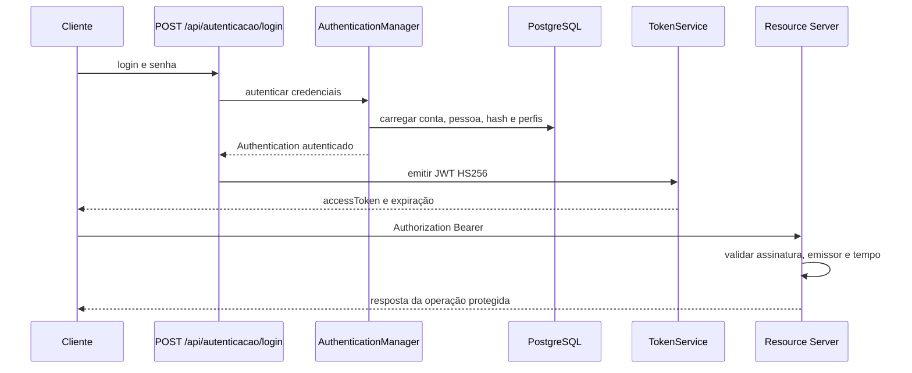

# Aula 13 — JWT e Bearer Token

[Projeto](../../README.md) · [Segurança](SEGURANCA.md) · [Atividade de transferência](ATIVIDADE-ORIENTADA.md) · [Evidências](EVIDENCIAS.md) · [Postman e Newman](POSTMAN.md)

Material oficial: [Aula 13 do professor Jefferson](https://github.com/jeffersonarpasserini/suporteos2026/blob/main/docs/13aula/13aula.md).

## Objetivo e evolução

A Aula 12 autenticava cada chamada com login e senha em HTTP Basic. A Aula 13 autentica as credenciais
uma vez no login e emite um JWT assinado com HS256. As chamadas seguintes apresentam Bearer.
O domínio comercial de instrumentos, fornecedores, pessoas, clientes, colaboradores, estoque e vendas foi preservado.
Não foram criadas migrações ou alteradas as regras de concorrência da Aula 11.

Ambiente validado: Java 21, Spring Boot 4.0.7, Spring Security 7.0.6 e PostgreSQL 17.6.
O starter `spring-boot-starter-oauth2-resource-server` usa o gerenciamento de versões do Boot.
O nome segue o professor; o Boot 4 o mantém por compatibilidade, embora recomende seu starter reorganizado.
Não foi trocado o nome da dependência neste checkpoint de auditoria.

## Configuração e execução

1. Prepare o PostgreSQL local e configure as variáveis de conexão conforme [.env.example](../../.env.example).
2. Copie o exemplo para `.env` local, que é ignorado pelo Git. Não sobrescreva um `.env` já configurado.
3. Se ainda não houver chave local, gere **32 bytes aleatórios**, codifique em Base64 e grave somente em `JWT_SECRET` no `.env`.
   Não use uma frase, a chave didática dos testes, capturas de terminal ou o clipboard compartilhado como distribuição de segredo.
4. O profile `dev` importa o `.env`; `prod` recebe variáveis do ambiente e não importa esse arquivo.

Exemplo PowerShell para preencher a chave local sem imprimi-la, somente depois de preparar o `.env`:

```powershell
$arquivoJwtLocal = Join-Path (Get-Location) '.env'
if (!(Test-Path -LiteralPath $arquivoJwtLocal)) { throw 'Prepare o .env local antes de gerar a chave.' }
if (Select-String -LiteralPath $arquivoJwtLocal -Pattern '^JWT_SECRET=' -Quiet) {
    throw 'JWT_SECRET já existe; confira localmente sem sobrescrever a chave.'
}
$bytesJwtLocal = New-Object byte[] 32
$geradorJwtLocal = [Security.Cryptography.RandomNumberGenerator]::Create()
try { $geradorJwtLocal.GetBytes($bytesJwtLocal) } finally { $geradorJwtLocal.Dispose() }
Add-Content -LiteralPath $arquivoJwtLocal -Value ('JWT_SECRET=' + [Convert]::ToBase64String($bytesJwtLocal))
[Array]::Clear($bytesJwtLocal, 0, $bytesJwtLocal.Length)
git check-ignore .env
```

Se o `.env` foi copiado do exemplo e ainda contém o placeholder, remova **apenas essa linha de placeholder**
localmente antes do comando. Não remova uma chave válida. A geração de uma nova chave invalida os tokens assinados com a anterior.
O comando é orientação para novas instalações, não evidência de nova geração durante a auditoria.

As propriedades em [application.properties](../../src/main/resources/application.properties) são:

| Propriedade | Configuração |
|---|---|
| `app.security.jwt.issuer` | `https://instrumento2026.local` |
| `app.security.jwt.expiration` | `PT30M` |
| `app.security.jwt.secret` | `${JWT_SECRET}`; valor real nunca documentado |

O emissor identifica o token; não configura HTTPS no servidor. O profile `test` utiliza chave didática própria,
diferente da chave local. Nunca execute `test` em produção.

```powershell
.\mvnw.cmd "-Dspring-boot.run.profiles=dev" spring-boot:run
```

Para execução no banco de testes e Newman, utilize o procedimento de [POSTMAN.md](POSTMAN.md),
que informa explicitamente o arquivo de propriedades de teste ao processo da aplicação.

## Fluxo e contrato



`POST /api/autenticacao/login` recebe `LoginRequest` (`login`, `senha`) e retorna HTTP **200** com
`TokenResponse` (`accessToken`, `tokenType=Bearer`, `expiresIn=1800`, `expiresAt`).
JSON ou dados inválidos retornam **400**. Login inexistente, senha errada, conta bloqueada e Pessoa inativa
retornam **401**, com a mesma mensagem genérica em `ApiError`.
Um Bearer inválido enviado inclusive a uma rota pública pode ser recusado antes pelos filtros;
seu 401 não possui o contrato JSON do erro de login. Use `No Auth` no login e nos cadastros públicos.

O login é normalizado com trim e minúsculas. A senha não é normalizada. Para preservar a Aula 12,
o limite da autenticação é de **72 bytes UTF-8** no `PasswordEncoder`, não apenas 72 caracteres no DTO.
Cadastro e troca continuam exigindo ao menos 12 pontos de código Unicode e no máximo 72 bytes.

O JWT contém somente `iss`, `sub` (login), `iat`, `exp`, `jti` e `perfis`. Perfis vêm do `Authentication`,
nunca do JSON do cliente. Login e perfis são dados identificadores: o token deve ser tratado como credencial sensível.
Nenhuma senha, hash, CPF ou chave é colocada no payload.

As rotas protegidas usam `Authorization: Bearer <accessToken obtido nesta execução>`.
No Swagger, faça o login, copie somente o accessToken para **Authorize** e consulte `/api/contas-acesso/me`.
O esquema `bearerAuth` acrescenta o prefixo. Não publique tokens ou credenciais em exemplos ou imagens.
Basic não autentica mais as operações protegidas. A política de sessão permanece `STATELESS`.

São públicos GET/HEAD de health e documentação (`/api/health`, `/v3/api-docs`, `/v3/api-docs/**`,
`/v3/api-docs.yaml`, `/swagger-ui.html`, `/swagger-ui/**`) e somente POST de `/api/pessoas`,
`/api/contas-acesso` e `/api/autenticacao/login`. As demais requisições exigem autenticação.
Em `prod`, OpenAPI e Swagger continuam desabilitados.

`GET /api/contas-acesso/me` (**200**) e `PUT /api/contas-acesso/me/senha` (**204**) usam o nome do Principal,
derivado do `sub` do JWT, sem confiar em ID fornecido pelo cliente. Regras e erros comerciais anteriores são preservados.

## Matriz de conformidade — encerramento e atividade

Os caminhos Java da tabela são relativos a `src/main/java/com/curso/instrumento2026`; testes a `src/test/java/com/curso/instrumento2026`.

| Requisito | Evidência inspecionada | Situação |
|---|---|---|
| Starter Resource Server com versão do Boot | `pom.xml`, inicialização e suíte | Atendido |
| Chave externa Base64, mínimo 32 bytes e HS256 fixo | `config/JwtConfig.java`; `config/JwtConfigTest.java`; conferência privada do `.env` ignorado | Atendido |
| Chave própria, emissor e duração adaptados | `.env` local não publicado; `application.properties`; `config/JwtProperties.java` | Atendido |
| Header, payload e assinatura; assinatura não é criptografia | [SEGURANCA.md](SEGURANCA.md) e [atividade](ATIVIDADE-ORIENTADA.md) | Atendido documentalmente |
| Login reutiliza AuthenticationManager e BCrypt existente | `service/AutenticacaoService.java`; `service/ContaAcessoUserDetailsService.java`; `PasswordEncoderConfig` preservado | Atendido |
| Falha genérica, conta e Pessoa ativas no login | `AutenticacaoJwtTest`, `ContaAcessoSecurityTest`, `ApiExceptionHandler` | Atendido |
| Claims iss/sub/iat/exp/jti/perfis sem credenciais | `service/TokenService.java`; `AutenticacaoJwtTest`; `service/TokenServiceTest` | Atendido |
| Clock injetado, 1800 segundos absolutos | `config/JwtConfig.java`; `TokenServiceTest` com relógio fixo | Atendido |
| Perfis controlados pelo servidor | `AutenticacaoJwtTest.perfisESubjectEnviadosNoJsonNaoDevemAlterarClaims` | Atendido |
| Assinatura, emissor, expiração, nbf e algoritmo | `JwtConfigTest`; `AutenticacaoJwtTest` | Atendido |
| Resource Server Bearer, Basic recusado e ausência de filtro manual | `config/SecurityConfig.java`; `AutenticacaoJwtTest`; inspeção de pacotes | Atendido |
| Proteção das rotas, stateless e públicos limitados por método | `SecurityConfig`; `ContaAcessoSecurityTest`; `AutenticacaoJwtTest` | Atendido |
| Identidade JWT nas operações /me e troca de senha | `ContaAcessoApiTest`; `AutenticacaoJwtTest`; `ContaAcessoController` | Atendido |
| Limites UTF-8 e ausência de normalização da senha | `ContaAcessoAutenticacaoLimiteDiagnosticoTest`; `ContaAcessoApiTest` | Atendido |
| OpenAPI Bearer JWT e exceções públicas | `config/OpenApiConfig.java`; 58 casos em `OpenApiDocumentationTest` | Atendido |
| Postman captura token e executa operações protegidas | coleção Aula 13, runner e resultados Newman | Atendido |
| Token válido, alterado, ausente e erros de tempo | `AutenticacaoJwtTest`; `JwtConfigTest`; Newman para válido/ausente/inválido | Atendido |
| Contratos históricos, estoque e vendas preservados | comparação com exportação Aula 10 em `OpenApiDocumentationTest`; suíte e assertions comerciais Newman | Atendido |
| Explicar bloqueio e propor revogação no tema individual | [atividade](ATIVIDADE-ORIENTADA.md), proposta sem implementação; testes de tokens anteriores | Atendido |
| Validação JUnit, JSON, Git e ausência de segredo/token ativo na entrega | [EVIDENCIAS.md](EVIDENCIAS.md) | Atendido após validação registrada |
| Execução manual pela interface gráfica Swagger/Postman | não executada; verificações HTTP automatizadas | Parcialmente atendido como validação de interface; não bloqueia o escopo automatizado |
| Versionamento e tag sugerida pelo professor | aguardam autorização explícita | Não atendido nesta etapa, intencionalmente |
| Autorização por perfil (Aula 14), refresh, logout, revogação, idle timeout, RSA/JWKS ou Authorization Server | não implementados nem prometidos | Fora do escopo da Aula 13 |

O número de testes do material corresponde ao projeto Suporte OS. Neste projeto a referência é a suíte real
de **510 testes**, sem eliminar cenários para reproduzir o total do professor.
Veja [limitações e classificação dos riscos](SEGURANCA.md). Esta documentação não afirma aptidão para produção.
