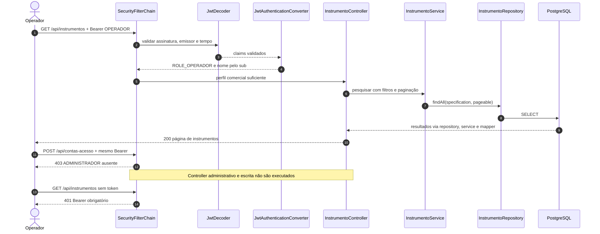
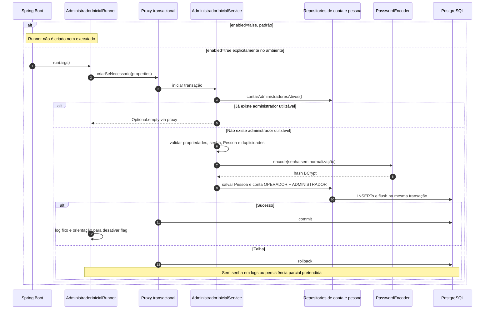

# Aula 14 — Atividade orientada e transferência

Esta atividade adapta o controle de acesso ao domínio de instrumentos musicais. A matriz está no
[README](README.md#matriz-http-implementada), o código em
[SecurityConfig](../../src/main/java/com/curso/instrumento2026/config/SecurityConfig.java), e as evidências
em [EVIDENCIAS.md](EVIDENCIAS.md). Os diagramas representam o código inspecionado, não execuções reais
realizadas no Checkpoint 7A. Naquele momento, interfaces gráficas e persistência real ainda não haviam
sido validadas. O registro final abaixo distingue as evidências posteriores.

## Login JWT

```mermaid
sequenceDiagram
    autonumber
    actor Cliente
    participant Controller as AutenticacaoController
    participant Service as AutenticacaoService
    participant Manager as AuthenticationManager
    participant Details as ContaAcessoUserDetailsService
    participant Repo as ContaAcessoRepository
    participant Banco as PostgreSQL
    participant Token as TokenService
    participant Encoder as JwtEncoder
    Cliente->>Controller: POST /api/autenticacao/login (login e senha)
    Controller->>Service: autenticar(login, senha)
    Service->>Manager: authenticate(credentials)
    Manager->>Details: loadUserByUsername(login)
    Details->>Repo: findByLoginIgnoreCase(login normalizado)
    Repo->>Banco: consultar conta, pessoa e perfis
    Banco-->>Details: dados persistidos
    Note over Manager,Details: Conta ATIVA, Pessoa ATIVO e PasswordEncoder
    alt Credenciais válidas
        Manager-->>Service: Authentication com ROLE_*
        Service->>Token: emitir(authentication)
        Token->>Encoder: assinar HS256 com perfis autenticados
        Encoder-->>Controller: TokenResponse via services
        Controller-->>Cliente: 200 accessToken, Bearer, expiresIn, expiresAt
    else Falha de autenticação
        Manager-->>Service: AuthenticationException
        Service-->>Controller: CredenciaisInvalidasException
        Note over Controller: ApiExceptionHandler produz ApiError genérico
        Controller-->>Cliente: 401 Login ou senha inválidos
    end
```

## Operação comercial permitida e administração proibida



## Alteração administrativa de perfis

```mermaid
sequenceDiagram
    autonumber
    actor Admin
    participant Filtros as SecurityFilterChain
    participant Controller as ContaAcessoController
    participant Proxy as Proxy Spring de ContaAcessoService
    participant Service as ContaAcessoService
    participant Repo as ContaAcessoRepository
    participant Banco as PostgreSQL
    Admin->>Filtros: PUT /api/contas-acesso/{id}/perfis + Bearer
    Filtros->>Controller: ROLE_ADMINISTRADOR validada
    Controller->>Proxy: alterarPerfis(id, request.perfis)
    Proxy->>Service: PreAuthorize e transação
    Service->>Repo: findOneById(id), EntityGraph pessoa/perfis
    Repo->>Banco: consultar conta
    Banco-->>Service: entidade gerenciada
    Note over Service: Ator obtido de SecurityContext, não do JSON
    alt Autorremoção de ADMINISTRADOR
        Service-->>Controller: IllegalArgumentException via proxy
        Controller-->>Admin: 400 ApiError
    else Remoção administrativa de outra conta utilizável
        Service->>Repo: contarAdministradoresAtivos()
        Repo->>Banco: COUNT conta ATIVA e Pessoa ATIVO
        Banco-->>Service: quantidade
        alt Quantidade menor ou igual a 1
            Service-->>Controller: IllegalArgumentException via proxy
            Controller-->>Admin: 400 ApiError, rollback
        else Há outro administrador utilizável
            Service->>Service: conta.substituirPerfis(validados)
            Proxy->>Banco: commit via JPA
            Controller-->>Admin: 200 ContaAcessoResponse pelo mapper
        end
    else Atualização sem remover administrador utilizável
        Service->>Service: conta.substituirPerfis(validados)
        Proxy->>Banco: commit via JPA
        Controller-->>Admin: 200 ContaAcessoResponse pelo mapper
    end
    Note over Admin,Banco: Tokens emitidos não mudam; contagem não é serializada
```

## Provisionamento administrativo



## Justificativa da política

O sistema de instrumentos musicais separa identidade, papel comercial e autorização. Pessoa representa dados civis; Cliente e Colaborador descrevem relações comerciais. ContaAcesso guarda credenciais e perfis de uso do sistema. Assim, ser vendedor não concede automaticamente poderes administrativos. A decisão utiliza os perfis autenticados pelo servidor, evitando que atributos enviados livremente no cadastro ou no login produzam privilégios.

OPERADOR recebe as atividades cotidianas: consultar cadastros, registrar Pessoas, administrar dados comerciais, movimentar estoque e trabalhar com vendas. ADMINISTRADOR também pode executar essas tarefas, mas assume responsabilidades adicionais de criação de contas, substituição de perfis, bloqueio e exclusão de recursos. Essa separação reduz a exposição de operações capazes de retirar acessos ou eliminar informações importantes para o funcionamento da loja.

A autorização começa na cadeia HTTP. Regras específicas de contas e exclusões aparecem antes da regra comercial geral, impedindo que uma correspondência ampla libere uma operação administrativa. Caminhos externos às regras terminam negados. Todos os DELETEs exigem administrador, inclusive remover item de venda, embora essa restrição imponha uma limitação operacional ao vendedor. A escolha mantém a política uniforme proposta na aula e fica explicitamente documentada.

A proteção continua nos serviços administrativos por meio de PreAuthorize. Os testes atravessam proxies Spring e verificam que chamadas negadas não consultam nem escrevem nos repositories. Isso oferece defesa em profundidade sem depender da interface ou de autoinvocação. Consultar a própria conta e trocar a própria senha permanecem acessíveis pelos dois perfis, usando o subject autenticado e a confirmação da senha atual.

O fechamento dos cadastros públicos exige outro caminho para a primeira identidade administrativa. O provisionamento condicional usa configuração privada, permanece desabilitado por padrão e cria Pessoa e conta na mesma transação. Não promove registros existentes silenciosamente nem publica senha na coleção. Depois da primeira criação, a flag deve ser desligada e as demais contas passam pela API protegida.

As invariantes evitam autorrebaixamento, autobloqueio e retirada do último administrador utilizável pelas operações de conta. Entretanto, a contagem não é serializada e a inativação de Pessoa não participa dessa proteção. Além disso, JWTs já emitidos conservam seus perfis até expirar. Essas limitações impedem prometer revogação imediata ou garantia administrativa global. A validação precisa combinar testes negativos, contratos comerciais preservados e execução posterior em banco descartável, sem confundir aprovação isolada com certificação de segurança em produção.

## Registro da realização

Conversão de perfis, política HTTP, proteção por método, endpoints e bootstrap foram implementados nos
Checkpoints 1–4. OpenAPI e coleção foram adaptados nos Checkpoints 5–6. Os testes isolados registram
401, 403 e operações permitidas. No 7A, suíte integral e observação HTTP/Postman reais ainda estavam
pendentes; a realização posterior está registrada abaixo.

## Realização final — atualização 7K

JUnit concluiu com **671 testes aprovados**, zero falhas, erros e ignorados, BUILD SUCCESS e código 0.
Newman executou as pastas 01–10: **156 chamadas HTTP e 487 assertions**, zero falhas e código 0.
Foram observados 401/403, criação administrativa 201, operações comerciais, promoção/restauração de
perfis, troca de senha, bloqueio e autoproteção. **A pasta 11 não foi executada** no Newman comum.
Validação estática: 155 definições, 163 scripts e 126 cenários históricos preservados.

O bootstrap foi observado em banco temporário isolado: PostgreSQL 17.6, cluster `7704384549022663752`,
`127.0.0.1:55414/instrumento2026_test`, schema public, 41 changeSets e lock liberado.
A limpeza confirmou zero fixtures comerciais remanescentes. As duas contas administrativas e duas
Pessoas de preparação permaneceram separadas do inventário Newman. A API foi encerrada e a instância
original na porta 5432 preservada.

A justificativa acima permanece com 378 palavras; os quatro diagramas correspondem ao código.
A execução posterior mencionada no encerramento da justificativa foi realizada, conforme
[EVIDENCIAS.md](EVIDENCIAS.md). Não há nova captura de tela, validação gráfica manual, teste de
rollback físico do bootstrap ou idempotência por reinicialização real. Permanecem as limitações de
concorrência administrativa, inativação indireta de Pessoa e authorities de tokens anteriores.
